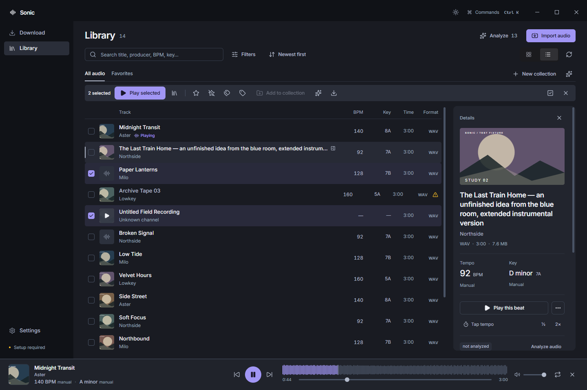
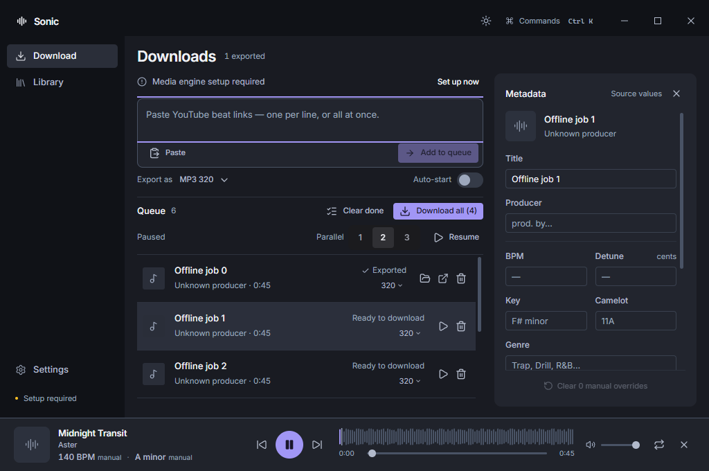

<p align="center">
  
</p>

<h1 align="center">Sonic</h1>

<p align="center">
  A local-first Windows workstation for turning tracks you are allowed to download<br />
  into tagged, producer-ready audio.
</p>

<p align="center">
  <a href="https://github.com/eterniastudio/sonic/blob/main/package.json"></a>
  <a href="https://github.com/eterniastudio/sonic/releases"></a>
  <a href="https://github.com/eterniastudio/sonic/actions/workflows/verify.yml"></a>
  <a href="https://github.com/eterniastudio/sonic/actions/workflows/release.yml"></a>
  <a href="https://github.com/eterniastudio/sonic/releases"></a>
  <a href="https://github.com/eterniastudio/sonic/releases"></a>
  <a href="https://github.com/eterniastudio/sonic/blob/main/package.json"></a>
  <a href="https://github.com/eterniastudio/sonic/blob/main/package.json"></a>
  <a href="https://github.com/eterniastudio/sonic/blob/main/package.json"></a>
</p>

<p align="center">
  <a href="#features">Features</a> ·
  <a href="#screenshots">Screenshots</a> ·
  <a href="#supported-sites">Supported sites</a> ·
  <a href="#installation">Installation</a> ·
  <a href="#usage">Usage</a> ·
  <a href="#building-from-source">Building</a> ·
  <a href="#contributing">Contributing</a> ·
  <a href="#license">License</a>
</p>

> **Use responsibly.** Sonic is for media you own or are allowed to download. It does not bypass DRM, sign-in walls, private posts, or geographic restrictions, and it is not affiliated with or endorsed by YouTube, SoundCloud, or any other site it can read.

Sonic is an Electron app for Windows 10 and Windows 11 (64-bit). It was called **Sonic V2** up to version 2.0.x; installing Sonic over it keeps your library, settings, and media engine. There is no account, no analytics, and no conversion server. Your library stays on the machine.

The app version is the `version` field in [`package.json`](package.json) (also recorded in `package-lock.json`). Electron reads that field, and the Windows installer is named from it. Releases are tagged `vX.Y.Z` to match.

---

## Features

- **Paste one link or many.** Each link is checked before anything is queued. YouTube playlists and Bandcamp albums open a track review; other collections are refused with a reason.
- **Tempo and key stay traceable.** A value can come from the title or description, an embedded tag, a local audio estimate, or a correction you typed. Manual corrections win. Disagreements are kept, and uncertain audio is reported as inconclusive rather than guessed.
- **Eight export recipes.** MP3 320, MP3 V0, M4A AAC 256, FLAC, WAV 44.1/24, WAV 48/24, Opus 192, and the original stream. Recipes can keep the channel layout or force stereo or mono, optionally normalise to a LUFS target, and embed the metadata you reviewed. A naming template previews the file name. A thumbnail that is not a real image is skipped; it does not fail the export.
- **A library that sits next to a DAW.** Import your own audio without rewriting the originals. Audition in the built-in player, keep notes, tags, and collections, and drag library rows into a DAW or Explorer (a selection drags together, up to 100 files). Reconnect a moved file with **Locate file…** or **Find missing files…**.
- **Producer views.** Favorites, recently added, needs review, and duplicates. **Find compatible tracks** uses the Camelot wheel and a BPM window. **Export list** writes the visible tracks, or the selection, as CSV or JSON without full file paths.
- **Local media engine.** On Windows, Sonic can download `yt-dlp` and FFmpeg into its own app-data folder and check the files against the publishers' SHA-256 manifests. Nothing is bundled in the installer.

The analyser, library performance work, and the White Label theme are written up in the [changelog](docs/CHANGELOG.md).

## Your first track

## Screenshots

The library and the download queue. The shipping theme is White Label: stamp-blue ink, square panels, and no accent picker.

<p align="center">
  
</p>

<p align="center">
  
</p>

---

## Supported sites

Paste a single-track link into the download box. Profiles, channels, and search pages are rejected when you paste them.

| Site | What Sonic accepts |
| --- | --- |
| YouTube | Videos, Shorts, and live replays. Playlists open a track review. |
| SoundCloud | Tracks, including private `s-…` links and `on.soundcloud.com` share links. Playlists and profiles are not supported. |
| Bandcamp | `artist.bandcamp.com/track/…`. Album links open a track review. |
| Vimeo | Videos, including unlisted links that carry their hash, and `player.vimeo.com` embeds. |
| Mixcloud | Shows (`mixcloud.com/user/show/`). |
| Audiomack | Songs. |
| Dailymotion | Videos and `dai.ly` short links. |
| Twitch | Clips and past broadcasts. Live channels are not supported. |
| TikTok | Videos and `vm.tiktok.com` short links. |
| Instagram | Public reels and posts. |
| Reddit | Posts with a video, and `v.redd.it` links. |
| Streamable | Videos. |
| X (Twitter) | Posts with a video. |
| Internet Archive | Item and file pages. |
| Direct files | An `https` link ending in `.mp3`, `.wav`, `.flac`, `.m4a`, `.aac`, `.ogg`, `.opus`, `.mp4`, or `.webm`. |

Only YouTube playlists and Bandcamp albums expand into a review. Every accepted site goes through the same export formats, metadata review, and audio analysis. YouTube artwork comes from the video thumbnail. Other sites use the thumbnail `yt-dlp` reports.

Links from other sites are refused unless **Settings → Media engine → Allow other sites** is on. That setting passes any other public `https` page to `yt-dlp`'s generic extractor. Results vary by site. Direct-file and other-site links are not fetched when the host is your own computer or a private network, including shorthand loopback spellings. Cover downloads follow redirects and apply the same check. Public content on the sites above needs no cookies. If a site asks for a signed-in session, choose a browser under **Use cookies from a browser**.

## Tempo and key you can inspect

## Installation

The supported download is the Windows installer attached to [GitHub Releases](https://github.com/eterniastudio/sonic/releases).

1. Open the [latest release](https://github.com/eterniastudio/sonic/releases/latest).
2. Download `Sonic-<version>-setup.exe` (64-bit).
3. Run the installer. It is per-user by default, lets you choose a folder, and can add Start menu and desktop shortcuts.
4. Launch **Sonic**. The first time you need the media engine, use **Set up now**. Sonic downloads `yt-dlp` and, if FFmpeg is not already available, a static Windows build.

### Updates

From 2.1.0 on, the installed app updates itself from GitHub Releases. It checks shortly after launch and every few hours, downloads a newer version in the background, and installs it when you close Sonic. **Restart to update** in the title bar, or **Settings → About → Restart and update**, installs it right away. **Settings → About** also shows the current version and has **Check for updates**. Sonic V2 2.0.x has no updater, so install 2.1.0 once by hand.

Keep `yt-dlp` current too: sites change often, and an outdated copy is the usual cause of failed downloads. **Settings → Media engine → Set up / update engine** replaces a Sonic-managed `yt-dlp` that is more than a week old.

Releases are unsigned unless the repository owner has configured code signing. Windows SmartScreen may warn on an unsigned installer. Signing secrets are listed under [Building from source](#building-from-source).

Requires Windows 10 or Windows 11, 64-bit.

| Recipes | Output | Useful for |
| --- | --- | --- |
| **MP3 320 · MP3 V0** | Constant 320 kbps or high-quality variable-bitrate MP3 | Sharing and broad player compatibility |
| **M4A AAC 256 · Opus 192** | AAC at 256 kbps or Opus at 192 kbps | Compact listening copies |
| **FLAC** | Lossless compression | Keeping decoded audio without another lossy encode |
| **WAV 44.1 / 24 · WAV 48 / 24** | 24-bit PCM at 44.1 or 48 kHz | DAW sessions and editing |
| **Original stream** | Acquired audio without re-encoding | Preserving the downloaded stream |

## Usage

1. Paste one or more links into **Download**, or press **Paste**. Choose an export recipe. **Add to queue**, then start the queue.
2. Open a job to review the title, producer, tempo, key, and genre. Each tempo and key shows where it came from. Adopt a measured value, or type your own. Your correction is not overwritten by a later analysis.
3. Exported files land in the folder from **Settings → Export**. The default is your Music folder's `Sonic` directory (an existing `Sonic V2` folder from before the rename stays the default). Names follow the naming template. Sonic-owned files can be renamed when you correct metadata later; imported originals are not rewritten. Re-export when you want new tags written into the audio.
4. Switch to **Library** to search, filter, collect, and play. Drag a row into your DAW or into Explorer. **Import audio** adds files you already have.

| Task | How |
| --- | --- |
| Command palette | `Ctrl+K` |
| Favorite | `F` on a focused row, or on the current selection |
| Compatible tracks | `C`, or right-click and choose **Find compatible tracks** |
| Clipboard watch | Off by default. **Settings → Advanced → Link intake**. When Sonic is focused again, it can offer to queue a copied link. Nothing is added until you confirm. With **Allow other sites** on, that offer includes other public `https` links. |
| Retry failures | **Retry failed** in the queue header, or the command palette. Cancelled jobs stay cancelled. |

A filename that contains a BPM does not set your DAW's project tempo. Read the badge and confirm the session tempo. Sonic's audio estimate can be inconclusive or wrong.

### Where your data lives

On Windows, Sonic uses `%APPDATA%\Sonic\`. On first launch after the rename, Sonic moves an existing `%APPDATA%\Sonic V2\` folder there; if the move is blocked, it keeps using the old folder in place.

| Path | Contents |
| --- | --- |
| `settings.json` | Preferences |
| `library.json` | Library records, including source links and artwork URLs |
| `organization.json` | Notes, tags, collections, and saved library view |
| `playback-session.json` | Last track, volume, and listening positions |
| `analysis-cache.json` | Analysis cached by file content and analyser version |
| `queue.json` | Queue, so a hard exit can resume |
| `engine\` | Managed `yt-dlp` and FFmpeg |
| `staging\` | In-progress downloads and conversions |
| `covers\` | Cached artwork |

The queue is saved on a short debounce. An interrupted job returns to the queue on the next launch.

Network access happens when you inspect or download a link, when the media engine is installed, when a thumbnail is fetched, and when the installed app checks GitHub Releases for an update.

| Files or folders | Contents |
| --- | --- |
| `settings.json` · `playback-session.json` | Preferences, last track, volume, and saved listening positions |
| `library.json` · `organization.json` | Track records, source links, artwork URLs, notes, tags, and collections |
| `queue.json` · `analysis-cache.json` | Saved queue and audio analysis cached by file content and analyzer version |
| `engine\` · `covers\` | Managed media tools and cached artwork |
| `staging\` · `analysis\` | Temporary downloads, conversions, and decoded analysis audio |

## Building from source

Install [Node.js 22 or newer](https://nodejs.org/) (the workflows use Node.js 24) and npm. The repository lockfile is `package-lock.json`.

```bash
git clone https://github.com/eterniastudio/sonic.git
cd sonic
npm ci
npm run dev
```

| Command | What it does |
| --- | --- |
| `npm run dev` | Vite dev server and Electron with hot reload |
| `npm run build` | Compile main, preload, and renderer into `out/` |
| `npm run typecheck` | Typecheck the Node and web projects |
| `npm run package` | Unpacked Windows x64 app in `release/` |
| `npm run dist` | NSIS installer and `latest.yml` update feed in `release/`, named `Sonic-<version>-setup.exe` |

`npm run package` and `npm run dist` pass `--win` to electron-builder. The installer target in [`electron-builder.yml`](electron-builder.yml) is NSIS for `x64` only. FFmpeg's automatic setup is Windows-only; on another system you would point Sonic at an FFmpeg you installed yourself, and that is not a supported desktop build. The release workflow runs `npm run dist` on `windows-latest`.

`npm run dist` does not publish by itself (`--publish never`). GitHub Releases are created by [`.github/workflows/release.yml`](.github/workflows/release.yml).

### Checks and releases

[`.github/workflows/verify.yml`](.github/workflows/verify.yml) runs `npm run typecheck` and `npm run build` on pull requests and on pushes to `main`.

[`.github/workflows/release.yml`](.github/workflows/release.yml) runs those same checks on every push to `main`, then builds the Windows installer and publishes it. [`scripts/release-version.mjs`](scripts/release-version.mjs) chooses the version:

- With no `vX.Y.Z` tags, the first release is the version in `package.json`.
- The next push of that same version becomes the next patch (`2.0.1`, `2.0.2`, …).
- If you set `package.json` higher than every existing tag, that version is used as-is.
- The workflow writes the version back into `package.json` and `package-lock.json` when they need to change, tags `vX.Y.Z`, and attaches `Sonic-<version>-setup.exe`, its `.blockmap`, and `latest.yml` to a GitHub Release. Installed copies read `latest.yml` to find updates, so every release on `main` reaches users automatically. The version-sync commit is marked `[skip ci]` so it does not release again.

Pushes are released one at a time. If `main` moves while a build is running, that build still publishes the commit it checked out, and the newest push is the one that fast-forwards `main`.

### Optional code signing

The installer is built and published with no secrets configured. To sign it, add these repository secrets. They are read only by the release workflow:

| Secret | Purpose |
| --- | --- |
| `WIN_CSC_LINK` | The Windows code-signing certificate as a base64-encoded `.pfx`, or an `https://` URL electron-builder can fetch. |
| `WIN_CSC_KEY_PASSWORD` | Password for that certificate. Leave it empty only when the certificate has no password. |

There is no macOS build, so Apple notarization secrets are not used.

The workflow's `GITHUB_TOKEN` is enough to push the version tag and create the Release. In the repository settings, **Actions → General → Workflow permissions** must be **Read and write permissions**. If `main` is protected, `github-actions[bot]` has to be allowed to push the `chore: release vX.Y.Z` commit. Without that, the tag and the Release can still be created, and the job fails when it cannot update `main`.

</details>

## Contributing

1. Fork the repository and create a branch from `main`.
2. `npm ci`
3. `npm run dev` while you work.
4. Before a pull request, run `npm run typecheck` and `npm run build`.

Pull requests run the [Verify workflow](.github/workflows/verify.yml) on Windows. The test suites are maintained privately and are not part of this repository, so `test:*`, `smoke`, and `benchmark:*` scripts in `package.json` do not run from a fresh clone.

Issues and pull requests are welcome for bugs and for changes that match the behaviour above. Please do not send changes whose purpose is to get around DRM, private access, or geographic restrictions.

---

## License

Sonic is free software under the [GNU General Public License v3.0](LICENSE) (`GPL-3.0-only`). Copyright © 2026 Eternia Studios.

The media engine Sonic downloads at runtime is separate software under its own licenses: [yt-dlp](https://github.com/yt-dlp/yt-dlp) (Unlicense) and the [BtbN FFmpeg builds](https://github.com/BtbN/FFmpeg-Builds) (GPL).

Bundled fonts (Archivo and Shantell Sans) remain under the SIL Open Font License.

---

## Further reading

- [What has changed](docs/CHANGELOG.md)
- [Releases and downloads](https://github.com/eterniastudio/sonic/releases)
- [Report a problem](https://github.com/eterniastudio/sonic/issues/new)
